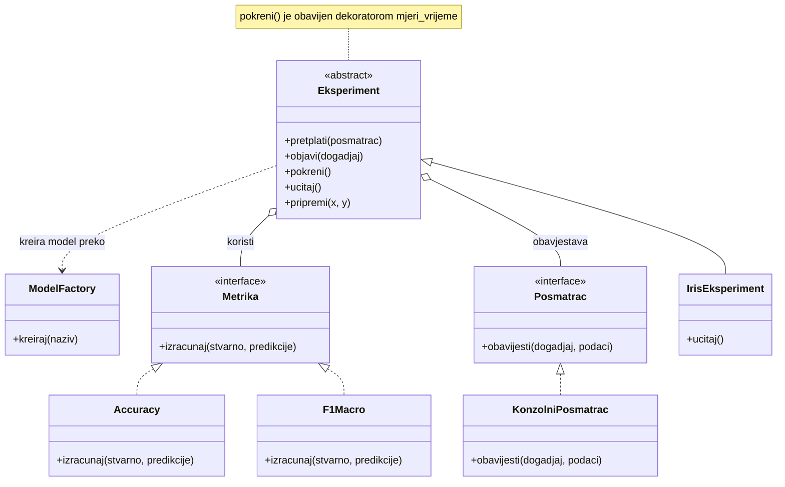

# Mini projekat 2 — Mini okvir za ML eksperimente

## Opis

Python projekat za izvršavanje klasifikacionih eksperimenata
na skupu podataka Iris.

Program omogućava izbor modela i metrike, praćenje događaja
tokom treninga i mjerenje trajanja eksperimenta.

## Pokretanje

Komande pokrenuti iz foldera mini_projekat_2.

Instalacija zavisnosti:

```bash
python -m pip install -r requirements.txt
```

Pokretanje demonstracije:

```bash
python main.py
```

Pokretanje testova:

```bash
python -m pytest -v
```

Provjera i formatiranje koda:

```bash
python -m ruff check .
python -m ruff format .
```

## Primijenjeni projektni šabloni

### Factory

ModelFactory kreira novi model prema nazivu iz registra.

Podržani modeli:
- logisticka regresija;
- stablo odlucivanja;
- k najblizih susjeda.

Za klasifikacioni primjer koristimo logisticku regresiju,
a ne linearnu regresiju.

### Strategy

Metrika definise zajednicki ugovor.

Accuracy i F1Macro implementiraju razlicite nacine
izracunavanja rezultata. Eksperiment prima metriku
kroz konstruktor, a ona se moze i naknadno zamijeniti.

### Observer

Eksperiment cuva listu posmatraca i salje im dogadjaje:
- pocetak_eksperimenta;
- pocetak_treninga;
- kraj_treninga;
- kraj_eksperimenta.

KonzolniPosmatrac ispisuje dogadjaje.
U testovima se koristi memorijski posmatrac.

Prati se pocetak i kraj fit poziva, ne pojedinacne epohe.

### Template Method

Eksperiment.pokreni() definise redosljed:
1. ucitavanje podataka;
2. podjela podataka;
3. kreiranje modela;
4. treniranje;
5. predikcija;
6. evaluacija.

IrisEksperiment implementira ucitavanje konkretnog skupa.

### Decorator

mjeri_vrijeme obavija metodu pokreni() i dodaje
vrijeme_sekunde u rezultat.

Mjeri se trajanje cijelog uspjesno zavrsenog eksperimenta,
ukljucujuci obavjestavanje posmatraca, a ne samo trening.

## Dijagram klasa



Metrika i Posmatrac su Python Protocol ugovori.
Konkretne klase ih strukturno ispunjavaju bez eksplicitnog
nasljedjivanja.

## Testovi

Testovi provjeravaju:
- kreiranje svih podrzanih modela;
- gresku za nepoznat model;
- kreiranje nezavisnih instanci;
- tacnost izracunavanja metrika;
- redosljed obavjestenja posmatracima;
- rad dekoratora;
- izvrsavanje eksperimenta za svaki model;
- zamjenu metrike.

### Rezultat lokalnog pokretanja

Pokrenuta je komanda:

python -m pytest -v

Rezultat: 13 passed in 1.18s.

Svih 13 testnih slucajeva je uspjesno proslo.

## Rezultati demonstracije

Rezultati dobijeni lokalnim pokretanjem programa na Iris skupu:

| Model | Accuracy | F1 macro |
|---|---:|---:|
| Logisticka regresija | 0.9333 | 0.9333 |
| Stablo odlucivanja | 0.9333 | 0.9333 |
| kNN | 0.9333 | 0.9327 |

Program je za svaki eksperiment ispisao dogadjaje pocetka
i kraja treninga, vrijednost metrike i ukupno vrijeme izvrsavanja.

## Upotreba AI alata

Alat: Perplexity.

Pocetni upit:
Prilozena je slika zadatka uz pitanje:
"Kako da ovakav projekat uradim uz tvoju pomoc, sve postupno"

AI je pomogao u izradi pocetne strukture projekta,
implementaciji sablona, predlogu testova i README dokumentacije.

### Licna provjera

- Instalirao sam zavisnosti projekta.
- Pokrenuo sam demonstraciju komandom python main.py.
- Program je izvrsio sest eksperimenata: tri modela sa po dvije metrike.
- Provjerio sam ispis dogadjaja, rezultata i vremena izvrsavanja.
- Pokrenuo sam testove komandom python -m pytest -v.
- Svih 13 testnih slucajeva je proslo.
- Pokrenuo sam Ruff provjeru i formatiranje koda.
- Ruff je prijavio RUF012 za klasni registar modela.
- Dodao sam ClassVar anotaciju za REGISTAR u klasi ModelFactory.
- Ponovo sam pokrenuo Ruff provjeru i testove.
- Ruff provjera je prosla bez prijavljenih gresaka.
- Svih 13 testnih slucajeva je ponovo proslo.

## Ogranicenja i moguca poboljsanja

- Primjer podrzava klasifikaciju, ne regresiju.
- Koristi jednu trening/test podjelu, bez unakrsne validacije.
- Nema pretragu hiperparametara.
- Posmatraci prate faze treninga, ne epohe.
- Greska posmatraca trenutno prekida eksperiment.
- Dekorator dodaje vrijeme samo kada se eksperiment uspjesno zavrsi.
- Any tipovi pojednostavljuju primjer, ali slabe staticku provjeru.
- Zavisnosti nijesu zakljucane na konkretne verzije.
